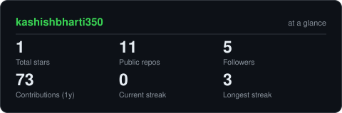
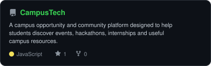
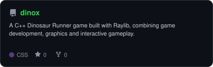

<div align="center">

  <!-- ANIMATED DOT-MATRIX PORTRAIT -->
  

  <br>

  <!-- ANIMATED TYPING HEADER -->
  <a href="https://github.com/kashishbharti350">
    
  </a>

  <br><br>

  <!-- SOCIAL LINKS -->
  <a href="https://github.com/kashishbharti350">
    
  </a>
  <a href="https://linkedin.com/in/kashish-bharti-bb0007378">
    
  </a>
  <a href="https://kashishbharti350.github.io/portfolio/">
    
  </a>
  <a href="mailto:bhartikashish865@gmail.com">
    
  </a>
  <a href="https://leetcode.com/u/kasbacodes/" target="_blank">
  
</a>

  <br><br>

  

</div>

---

## `~/` whoami

```console
$ cat about.txt
```

Hi, I'm **Kashish Bharti**, an Electronics and Communication Engineering student at **BPIT, Delhi**, passionate about building things with technology, code and creativity.

- Currently exploring **Full-Stack Web Development and React.js**
- Building projects that combine **technology, creativity and problem-solving**
- **3rd Place Winner** – Hack the Happiness, DTU Invictus Tech Fest
- Hackathon enthusiast with experience in multiple hackathons
- Exploring **DSA, Open Source and Competitive Programming**
- Creative side: **Graphic Design, Canva and UI/UX**
- Goal: Turning innovative ideas into useful products through technology.

- **Technical Society:** Member of Namespace, BPIT.
- **Hackathon Achievement:** 3rd Place – Hack the Happiness, DTU Invictus Tech Fest (February 2026).
- **Hackathon Experience:** Participated in 10+ hackathons, gaining experience in teamwork, ideation, problem-solving and rapid prototyping.


### Currently Building

- **[CampusTech](https://github.com/kashishbharti350/CampusTech)** – A student-focused platform for discovering campus opportunities, events and resources.
- **[DinoX](https://github.com/kashishbharti350/dinox)** – A dinosaur runner game built using C++ and Raylib.
- **[Personal Portfolio](https://kashishbharti350.github.io/portfolio/)** – My developer portfolio showcasing projects, skills and creative work.

Fun fact: I love turning creative ideas into real projects!

---

<div align="center">

## `~/` toolbox


</div>

---

<div align="center">

## `~/` skill radar

<table>
<tr>
<td width="50%" align="center" valign="middle">

<!-- Self-rated skill radar -->
<picture>
  <source media="(prefers-color-scheme: dark)" srcset="assets/radar-dark.svg">
  <source media="(prefers-color-scheme: light)" srcset="assets/radar-light.svg">
  
</picture>

</td>
<td width="50%" align="center" valign="middle">

<!-- Live programming language radar -->
<picture>
  <source media="(prefers-color-scheme: dark)" srcset="assets/radar-langs-dark.svg">
  <source media="(prefers-color-scheme: light)" srcset="assets/radar-langs-light.svg">
  
</picture>

</td>
</tr>
</table>

</div>

---

<div align="center">

## `~/` contribution calendar

<!-- 3D contribution calendar -->


<br><br>

<!-- Animated contribution snake -->
<picture>
  <source media="(prefers-color-scheme: dark)" srcset="https://raw.githubusercontent.com/kashishbharti350/kashishbharti350/output/snake-dark.svg">
  <source media="(prefers-color-scheme: light)" srcset="https://raw.githubusercontent.com/kashishbharti350/kashishbharti350/output/snake.svg">
  
</picture>

</div>

---

<div align="center">

## `~/` the numbers

<!-- Locally generated GitHub statistics -->
<picture>
  <source media="(prefers-color-scheme: dark)" srcset="assets/card-stats-dark.svg">
  <source media="(prefers-color-scheme: light)" srcset="assets/card-stats-light.svg">
  
</picture>

<br>


<br><br>


</div>

---

<div align="center">

## `~/` selected work

<!-- Generated project cards -->

<table>
<tr>
<td width="50%">
  <a href="https://github.com/kashishbharti350/CampusTech">
    <picture>
      <source media="(prefers-color-scheme: dark)" srcset="assets/card-CampusTech-dark.svg">
      <source media="(prefers-color-scheme: light)" srcset="assets/card-CampusTech-light.svg">
      
    </picture>
  </a>
</td>
<td width="50%">
  <a href="https://github.com/kashishbharti350/dinox">
    <picture>
      <source media="(prefers-color-scheme: dark)" srcset="assets/card-dinox-dark.svg">
      <source media="(prefers-color-scheme: light)" srcset="assets/card-dinox-light.svg">
      
    </picture>
  </a>
</td>
</tr>
</table>

</div>

### More about my projects

| Project | Description | Technologies |
|---|---|---|
| [CampusTech](https://github.com/kashishbharti350/CampusTech) | Campus opportunities and student resources platform | HTML, CSS, JS, Node.js, MongoDB |
| [DinoX](https://github.com/kashishbharti350/dinox) | Dinosaur runner game | C++, Raylib |
| [Portfolio](https://kashishbharti350.github.io/portfolio/) | Personal developer portfolio | HTML, CSS, JavaScript |

---

<div align="center">

### `~/` thanks for scrolling

**Building. Learning. Creating. Repeating.**

<sub>01101011 01100001 01110011 01101000 01101001 01110011 01101000</sub>

</div>
